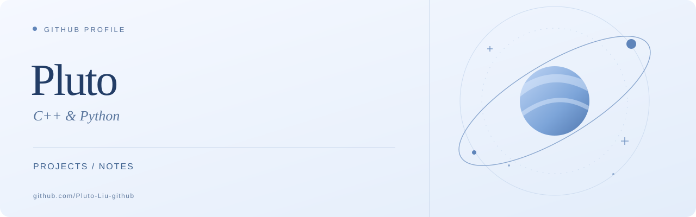

  <a href="./README.md">English</a> &nbsp; | &nbsp; <strong>简体中文</strong>

  

  联系邮箱：<a href="mailto:k0iz@hrbeu.edu.cn">k0iz@hrbeu.edu.cn</a>

  <a href="#关于我">关于我</a> &nbsp; / &nbsp;
  <a href="#笔记">笔记</a> &nbsp; / &nbsp;
  <a href="https://github.com/Pluto-Liu-github?tab=repositories">全部仓库 ↗</a>

 

## 关于我

你好，我是 **Pluto**，主要使用 **C++** 和 **Python**。

这个账号用于存放项目代码和学习笔记。

 

## 笔记

[学习笔记目录 →](https://github.com/Pluto-Liu-github/Pluto-Liu-github/blob/master/notes/README.md)（暂未收录内容）
